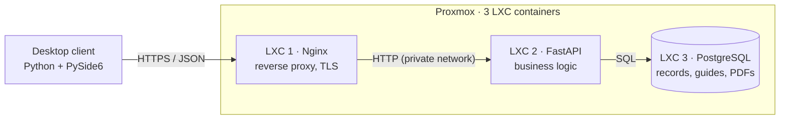
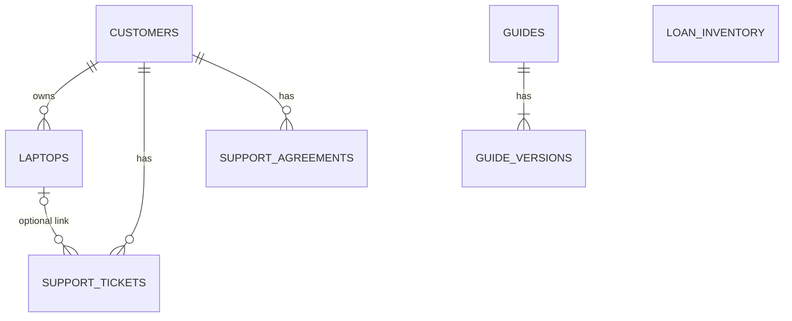

# Company Brain

Internal support app for **Ember Island IT Services** (fictional). A support technician can look up a laptop, find its customer and the support agreement in force, review past tickets, and open the current support guide.

> Status: early development. The stack below is proposed and has to be confirmed by the whole team.

## Architecture



- Only Nginx (LXC 1) is reachable from the client network.
- The API (LXC 2) and the database (LXC 3) communicate over the private container network.
- The client never connects to the database directly.

## Tech stack

| Layer | Technology |
| --- | --- |
| Desktop client | Python + PySide6 |
| API | Python + FastAPI, Pydantic |
| Database access | SQLAlchemy 2 + Alembic |
| Database | PostgreSQL (full-text search for guides) |
| Reverse proxy | Nginx + self-signed TLS |
| Quality | pytest + Ruff, GitHub Actions |
| Project management | GitHub Projects board |
| Deployment | Debian/Ubuntu LXC + systemd |

## Data model



Rules:
- Every laptop, agreement and ticket belongs to a customer. A ticket can also reference a laptop, and if it does, that laptop must belong to the same customer.
- **Agreement in force:** `valid_from <= date <= valid_until`, and the end date counts as part of the agreement.
- **Guide in force:** a `published` or `archived` version whose effective dates include the requested date. **Drafts never take effect.**
- The loan inventory is a snapshot, so the client must show it as "last recorded status", not as confirmed availability.

## Team split

Each person owns one layer and also builds one feature through all layers (database, API and UI), so everyone can explain the whole system.

| Person | Layer | Container | Feature slice |
| --- | --- | --- | --- |
| A | Data and database: schema, Alembic migrations, importer, search indexes | LXC 3 | Tickets |
| B (Erik) | Backend API: endpoints, business rules, OpenAPI docs, tests | LXC 2 | Agreements and PDFs |
| C | Desktop client: views, API client, Markdown guide viewer | – | Guide search and version history |
| D | Infra, DevOps and docs: Proxmox, network, Nginx, CI, board | LXC 1 | Loan inventory |

### Schedule

| Week | Work |
| --- | --- |
| 1 | Together: API contract (`backend/app/schemas.py`), data model, repo, board, issues |
| 2 | A: schema and importer · B: core endpoints and tests · C: views with mock data · D: containers, Nginx, CI |
| 3 | Everyone builds their slice. C connects the client to the real API. D does the first deploy. |
| 4 | Test the LT-1042 scenario end to end, fix bugs, finish docs. Everyone deploys once themselves. |
| Bonus | RAG (A + B), web frontend (C + D) |

### Working rules
- One issue per task on the board: owner, status and acceptance criteria.
- Short-lived branch per issue, then a PR, then a review **by someone from another layer**, then a green CI run, then merge to `main`.
- A 15-minute demo every week.

## Acceptance scenario

A customer calls at 17:30 on Friday 20 November 2026: laptop **LT-1042** will not start.

1. Search for LT-1042. The app shows the customer, West Quay Accounting (CUST-002).
2. Open the agreement in force, AGR-002-2026B (Premium). It includes one loan laptop.
3. Review earlier tickets for the laptop (HD-218).
4. Find and open the current after-hours guide (GUIDE-103) with its Markdown formatting.

## Repository

```
company-brain/
├── backend/       FastAPI app (LXC 2). See backend/README.md for the API docs.
├── client/        PySide6 desktop app (to do)
├── deployment/    Nginx, systemd and container setup (to do)
├── docs/          Architecture and deployment docs (to do)
└── sample-data/   Course-supplied sample data (CSV, JSON, PDF, Markdown)
```

## Quick start (backend)

```bash
cd backend
python -m venv .venv
.venv\Scripts\activate            # Windows  (Linux/macOS: source .venv/bin/activate)
pip install -e ".[dev]"
python -m scripts.seed_dev ../sample-data --reset
uvicorn app.main:app --reload     # http://127.0.0.1:8000/docs
pytest
```
